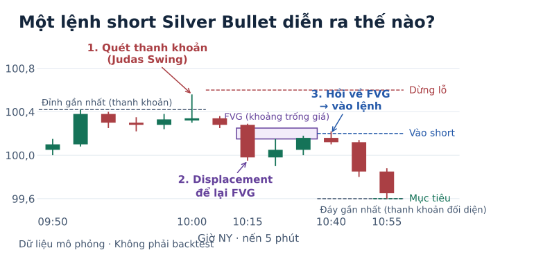
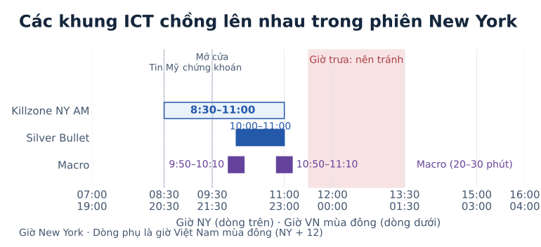

# Giao dịch theo khung giờ New York và khung giờ ICT

Trang này tóm tắt các cách giao dịch phổ biến quanh phiên New York và các khung giờ của ICT (Inner Circle Trader, một trường phái phân tích hành động giá). Mọi mốc giờ đều tính theo múi giờ `America/New_York`, đã gồm giờ mùa hè và mùa đông (DST). Nội dung là tổng hợp nghiên cứu, không phải khuyến nghị đầu tư.

## Vì sao phiên New York đáng chú ý?

- Lúc 8:30, Mỹ công bố các tin kinh tế lớn: CPI, NFP (bảng việc làm phi nông nghiệp), Retail Sales.
- Lúc 9:30, thị trường chứng khoán Mỹ mở cửa (NYSE và Nasdaq).
- Khoảng 8:00–11:00, London và New York cùng mở cửa nên thanh khoản cao nhất trong ngày.
- Vì vậy giá thường tạo đỉnh hoặc đáy của ngày và có xu hướng rõ trong khung này.
- Khoảng 11:30–13:30 là giờ trưa: thanh khoản thấp, giá thường đi ngang. Phần lớn trader, kể cả người theo ICT, tránh khung này.

## Quy đổi sang giờ Việt Nam (UTC+7)

- **Giờ mùa đông của Mỹ (EST, UTC−5):** giờ VN = giờ NY + 12.
- **Giờ mùa hè của Mỹ (EDT, UTC−4):** giờ VN = giờ NY + 11.
- Ngày bắt đầu và kết thúc mỗi chế độ nằm ở phần [chi tiết](#quy-tac-doi-gio). Mỹ và Anh đổi giờ vào các ngày khác nhau, nên mỗi năm có vài tuần New York và London chỉ lệch nhau 4 giờ thay vì 5 giờ.

| Mốc | Giờ NY | Giờ VN (mùa đông) | Giờ VN (mùa hè) |
| --- | --- | --- | --- |
| Tin Mỹ | 8:30 | 20:30 | 19:30 |
| Mở cửa cổ phiếu | 9:30 | 21:30 | 20:30 |
| Silver Bullet sáng | 10:00–11:00 | 22:00–23:00 | 21:00–22:00 |
| London Fix | 11:00 | 23:00 | 22:00 |
| Giờ trưa (nên tránh) | 11:30–13:30 | 23:30–01:30 | 22:30–00:30 |
| Silver Bullet chiều | 14:00–15:00 | 02:00–03:00 | 01:00–02:00 |
| Đóng cửa cổ phiếu | 16:00 | 04:00 | 03:00 |

## Các phương pháp phổ biến trong phiên New York

| Phương pháp | Cách làm | Ghi chú |
| --- | --- | --- |
| Opening Range Breakout (ORB) | Đánh dấu đỉnh/đáy 5–30 phút đầu sau 9:30, vào lệnh khi giá phá ra | Nghiên cứu trên QQQ báo lãi; bản chạy lại độc lập thấy lợi thế gần như mất hết khi tính trượt giá (Sharpe 1,06 → 0,23). Xem trang [ORB](opening-range-breakout.md) |
| Range 8:00–9:30 cho Forex | Range gồm cả nến tin 8:30; chờ nến 15 phút đóng ngoài range trong 9:30–11:30, dừng lỗ ở giữa range, chốt ở 2R (lãi bằng 2 lần khoảng cách từ giá vào tới dừng lỗ) | Bỏ qua ngày có range quá nhỏ hoặc quá lớn so với ATR ngày (biên độ thực trung bình) [1] |
| Initial Balance (Market Profile) | Lấy range giờ giao dịch đầu tiên (9:30–10:30), theo dõi giá phá ra hay quay lại | Backtest trên NQ/ES gần như hòa vốn trước phí [2] |
| VWAP / Anchored VWAP | Giá trung bình gia quyền theo khối lượng; giá giữ trên VWAP thì theo xu hướng, cắt mạnh qua thì có thể đảo chiều | Thường dùng làm bối cảnh, không phải tín hiệu độc lập |
| Trade theo tin 8:30 | Chờ giá ổn định sau tin rồi theo hướng đã chọn, không đoán trước tin | Spread giãn và trượt giá lớn |
| London Fix (11:00 NY) | Dòng tiền tái cân bằng danh mục quanh mốc định giá WM/Reuters gây đảo chiều hoặc tăng tốc trên EURUSD/GBPUSD | Xảy ra cuối giai đoạn London và New York cùng mở cửa |

## ICT trong phiên New York

**ICT áp dụng được vào phiên New York**, vì toàn bộ khung thời gian của ICT đã được tính theo giờ New York ngay từ đầu. Ba khái niệm thời gian cần phân biệt: Killzone, Silver Bullet và Macro.

### Killzone: khung vài giờ

Killzone là các khung giờ ICT kỳ vọng có biến động. Chúng chỉ là bối cảnh thời gian, không phải tín hiệu vào lệnh.

| Killzone | Giờ NY | Giờ VN (mùa đông) | Giờ VN (mùa hè) |
| --- | --- | --- | --- |
| Asia | 20:00–00:00 | 08:00–12:00 | 07:00–11:00 |
| London | 02:00–05:00 | 14:00–17:00 | 13:00–16:00 |
| NY AM | 08:30–11:00 | 20:30–23:00 | 19:30–22:00 |
| London Close | 10:00–12:00 | 22:00–00:00 | 21:00–23:00 |
| NY PM | 13:30–16:00 | 01:30–04:00 | 00:30–03:00 |

Các nguồn không thống nhất giờ Killzone; xem phần [chi tiết](#gio-killzone-khac-nhau).

### Judas Swing

Quanh giờ mở cửa London hoặc New York 9:30, giá thường chạy sai hướng một đoạn để quét lệnh dừng lỗ (stop) của đám đông, rồi mới đi theo hướng thật của ngày. ICT gọi nhịp này là Judas Swing. Nó thường là bước "quét thanh khoản" đứng trước một setup Silver Bullet.

### Silver Bullet: khung 1 giờ có quy tắc vào lệnh

| Silver Bullet | Giờ NY | Giờ VN (mùa đông) | Giờ VN (mùa hè) |
| --- | --- | --- | --- |
| London | 03:00–04:00 | 15:00–16:00 | 14:00–15:00 |
| NY AM | 10:00–11:00 | 22:00–23:00 | 21:00–22:00 |
| NY PM | 14:00–15:00 | 02:00–03:00 | 01:00–02:00 |

Các bước, lấy ví dụ lệnh bán khống:

1. Chờ đến giờ mở khung.
2. Chờ giá quét thanh khoản ở một đỉnh hoặc đáy gần nhất: với lệnh bán, giá vượt qua đỉnh rồi quay lại. Đây chính là Judas Swing.
3. Chờ một nhịp chạy mạnh (displacement) ngược lại, để lại một khoảng trống giá gọi là FVG (Fair Value Gap).
4. Vào lệnh khi giá hồi về FVG. Dừng lỗ đặt sau đỉnh vừa bị quét; mục tiêu là vùng thanh khoản phía đối diện.

*Dữ liệu mô phỏng, không phải kết quả kiểm thử. Với lệnh mua, đảo ngược chiều: giá quét qua đáy gần nhất, displacement đi lên để lại FVG, vào lệnh khi giá hồi xuống FVG.*

### Macro: khung 20–30 phút

Macro là các cửa sổ ngắn theo giờ New York, nằm lọt trong Killzone. ICT cho rằng trong các khung này giá thường quét thanh khoản hoặc chạy về lấp FVG, rồi tăng tốc theo một hướng. ICT gọi cơ chế đó là "IPDA" (Interbank Price Delivery Algorithm).

**Macro chỉ cho biết lúc nào cần chú ý, không cho biết nên mua hay bán.** Hướng lệnh và điểm vào vẫn phải lấy từ xu hướng khung lớn (bias) và setup riêng của bạn.

| Macro | Giờ NY | Giờ VN (mùa đông) | Giờ VN (mùa hè) |
| --- | --- | --- | --- |
| London 1 | 02:33–03:00 | 14:33–15:00 | 13:33–14:00 |
| London 2 | 04:03–04:30 | 16:03–16:30 | 15:03–15:30 |
| NY trước mở cửa | 08:50–09:10 | 20:50–21:10 | 19:50–20:10 |
| NY AM 1 | 09:50–10:10 | 21:50–22:10 | 20:50–21:10 |
| NY AM 2 | 10:50–11:10 | 22:50–23:10 | 21:50–22:10 |
| NY trưa ("Launch") | 11:50–12:10 | 23:50–00:10 | 22:50–23:10 |
| NY PM | 13:10–13:40 | 01:10–01:40 | 00:10–00:40 |
| NY cuối phiên | 15:15–15:45 | 03:15–03:45 | 02:15–02:45 |

Giờ Macro giống nhau giữa các nguồn, nhưng tên gọi thì khác [3–5]. Một số indicator tự thêm các khung ngoài danh sách gốc; xem phần [chi tiết](#ten-macro).

Cách dùng thực tế:

- Đánh dấu đỉnh và đáy của từng Macro. Macro sau thường được kỳ vọng sẽ quét các mức đó.
- Dùng biểu đồ 1–5 phút, vì mỗi khung rất ngắn.

### Các khung ICT lồng vào nhau như thế nào

- **Killzone** là khung vài giờ, ví dụ NY AM 8:30–11:00.
- **Silver Bullet** là khung 1 giờ nằm trong Killzone, ví dụ 10:00–11:00, và có quy tắc vào lệnh cụ thể.
- **Macro** là khung 20–30 phút nằm lọt trong Killzone. Hai Macro 09:50–10:10 và 10:50–11:10 chồng lên đầu và cuối khung Silver Bullet NY AM (mỗi khung nhô ra 10 phút); nhiều người dùng chúng để canh thời điểm vào lệnh chính xác hơn.

*Giờ New York, dòng phụ là giờ Việt Nam mùa đông (NY + 12). Trình tự thường thấy: mở cửa 9:30 → Judas Swing quét stop quanh Macro 9:50 → đầu khung Silver Bullet, một nhịp chạy mạnh để lại FVG → vào lệnh khi giá hồi về FVG.*

## Số liệu nói gì?

Các bài backtest độc lập tìm được **chưa cho thấy setup ICT nào có lợi thế rõ ràng sau khi trừ phí**.

| Nghiên cứu | Phạm vi | Kết quả |
| --- | --- | --- |
| RezSync [6] | 1.461 lệnh Silver Bullet, vàng / US100 / US500, 2 năm, có tính phí | Trung bình khoảng −0,01R mỗi lệnh, tỷ lệ thắng 43%, tương đương vào lệnh ngẫu nhiên |
| Thinridge [7] | Silver Bullet, 11 hợp đồng tương lai, 2008–2026, có tính phí, so với 5.000 lần vào lệnh ngẫu nhiên | Không thị trường nào thắng được mốc tham chiếu ngẫu nhiên; chỉ vàng (GC) gần đạt |
| TradingEdgeJournal [8] | ES/NQ, dữ liệu 1 phút 2010–2026 | 0/288 biến thể sweep → FVG có ý nghĩa thống kê, dù vị trí vào lệnh vẫn tốt hơn vào ngẫu nhiên một chút |
| StatOasis [9] | SPY / QQQ / IWM / DIA, dữ liệu ngày | 31/32 thống kê kiểm định (t-stat) của các khái niệm ICT không vượt ngưỡng 2. Giá có quay về FVG, nhưng không có lợi thế về lợi nhuận sau đó |
| SSRN (Mahadzva) [10] | 6 quy tắc ICT/SMC, EURUSD / GBPUSD / AUDUSD / USDJPY | Không thấy hiệu quả khi làm đúng như ICT dạy. Sau khi quét thanh khoản, giá thường tiếp diễn chứ không đảo chiều như sách |
| DoesItRepeat [11] | Silver Bullet theo 620 video ICT | Quy tắc không thực sự "máy móc"; không có biến thể nào ổn định |

## Điều số liệu chưa trả lời

- **Phần lớn nguồn là blog backtest tự công bố**, không phải nghiên cứu đã qua bình duyệt (peer review).
- **Họ chỉ test một cách diễn giải "máy móc" của ICT.** Người trade thật còn dùng phán đoán và bối cảnh khung lớn, phần đó không vào được backtest.
- **Chưa có backtest độc lập nào test riêng Macro.**
- **Kết quả trên một thị trường không suy ra thị trường khác.** Vàng (GC) là thị trường duy nhất gần đạt trong bảng trên.

## Tự kiểm tra trước khi dùng

1. **Lấy phần chắc chắn nhất của ICT: khung giờ và mức thanh khoản.** Khung 8:30–11:00 NY đáng chú ý vì thanh khoản và tin tức tập trung thật ở đó, không cần tin vào cơ chế IPDA. Đánh dấu đỉnh/đáy phiên Á, phiên London và ngày hôm trước.
2. **Không tin tỷ lệ thắng 70–80% được quảng cáo.** Kết hợp khung giờ với một bộ quy tắc rõ ràng (ví dụ ORB hoặc range 8:00–9:30 kèm bộ lọc ICT), rồi tự backtest có tính phí và so với vào lệnh ngẫu nhiên.
3. **Ghi cả những ngày không có setup.** Nếu chỉ lưu các ví dụ đẹp, thống kê của bạn sẽ lạc quan hơn thực tế.
4. **Chú ý lịch đổi giờ, ngày có tin lớn và chi phí giao dịch.** Với dừng lỗ nhỏ, spread và trượt giá có thể ăn hết lợi nhuận. Kiểm tra lại giờ quy đổi sau mỗi lần Mỹ đổi giờ mùa hè/đông.

## Chi tiết để đối chiếu

### Quy tắc đổi giờ mùa hè/mùa đông của Mỹ

- **Giờ mùa đông (EST, UTC−5):** từ Chủ nhật đầu tiên của tháng 11 (gần nhất: 1/11/2026) đến Chủ nhật thứ hai của tháng 3 (tiếp theo: 14/3/2027). Giờ VN = giờ NY + 12.
- **Giờ mùa hè (EDT, UTC−4):** từ Chủ nhật thứ hai của tháng 3 đến Chủ nhật đầu tiên của tháng 11. Giờ VN = giờ NY + 11.
- Anh đổi giờ vào Chủ nhật cuối của tháng 3 và tháng 10, khác ngày với Mỹ. Trong khoảng lệch lịch đó, London và New York chỉ cách nhau 4 giờ thay vì 5 giờ, nên giờ "overlap" và London Fix theo giờ VN cũng dịch đi. Cụ thể, London Fix 16:00 giờ London khi đó rơi vào 12:00 New York thay vì 11:00.

### Giờ Killzone khác nhau giữa các nguồn

- NY AM: nguồn chính ghi 8:30–11:00, nguồn khác ghi 7:00–10:00.
- Asia: nguồn chính ghi 20:00–00:00, nguồn khác ghi 19:00–22:00.
- Khi dùng indicator Killzone, kiểm tra giờ nó đang hiển thị thay vì mặc định là giờ chuẩn.

### Tên Macro và các khung bổ sung

- Giờ Macro giống nhau giữa các nguồn [3–5], nhưng tên khác nhau: ví dụ khung 10:50–11:10 có nơi gọi theo London Fix.
- Một số indicator tự thêm các khung không thuộc danh sách gốc: 09:30–09:50, 13:50–14:10, 14:50–15:10, 19:50–20:10, 20:50–21:10.
- Trong bảng trên, "NY trưa" là cách gọi thông dụng; một số nguồn gọi khung 11:50–12:10 là "Launch".

## Nguồn

**Các phương pháp phiên New York**

- [1] PipLedgerFX, [New York Session Strategy (range 8:00–9:30)](https://pipledgerfx.com/new-york-session-strategy).
- [2] TradingStats, [ORB / Initial Balance trên ES & NQ](https://tradingstats.net/orb-breakout-strategy-guide/).
- Zarattini & Aziz, [Can Day Trading Really Be Profitable?](https://papers.ssrn.com/sol3/papers.cfm?abstract_id=4416622) (SSRN); [bản chạy lại độc lập trên QQQ](https://github.com/giovannibrusco/zarattini-2023-orb-qqq).
- FXNX, [London–New York overlap với EURUSD](https://fxnx.com/en/blog/london-new-york-overlap-eur-usd-how-trade-peak-volatility) và [Anchored VWAP theo phiên](https://fxnx.com/en/blog/anchored-vwap-forex-charts-where-anchor).

**Khung giờ ICT**

- [3] Hadal Instruments, [ICT Macro Times](https://hadalinstruments.com/glossary/ict-macro-times/).
- [4] LuxAlgo, [ICT Macros indicator](https://www.luxalgo.com/library/indicator/ict-macros/).
- [5] WickCheck, [ICT Macros](https://wickcheck.com/learn/ict-macros/); LiquidityScan, [Killzone vs Macro vs Silver Bullet](https://liquidityscan.io/blog/kill-zone-vs-macro-vs-silver-bullet-how-icts-time-windows-nest); [giờ Killzone](https://www.ictkillzone.com/ict-kill-zones) và [giờ theo UTC](https://proea.app/en/tools/ict-killzone-times/utc); [indicator Macro](https://fibalgo.com/library/ict-macro-times).

**Backtest và đánh giá ICT**

- [6] RezSync, [1.461 lệnh Silver Bullet](https://rezsync.com/algo/research/does-the-ict-silver-bullet-work).
- [7] Thinridge, [Backtest Silver Bullet trên 11 hợp đồng tương lai](https://thinridge.io/ict-silver-bullet.html).
- [8] TradingEdgeJournal, [Is ICT Trading Profitable?](https://tradingedgejournal.com/blog/is-ict-trading-profitable/).
- [9] StatOasis, [ICT Backtest: What Survives](https://statoasis.com/overfit/research/ict-backtest-what-survives).
- [10] Mahadzva, [Smart Money or Costly Folklore?](https://papers.ssrn.com/sol3/papers.cfm?abstract_id=7430998) (SSRN).
- [11] DoesItRepeat, [Silver Bullet theo 620 video ICT](https://doesitrepeat.com/blog/ict-silver-bullet-backtest).
