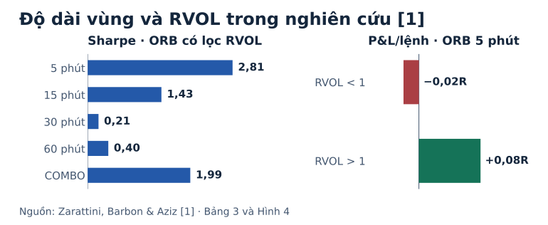
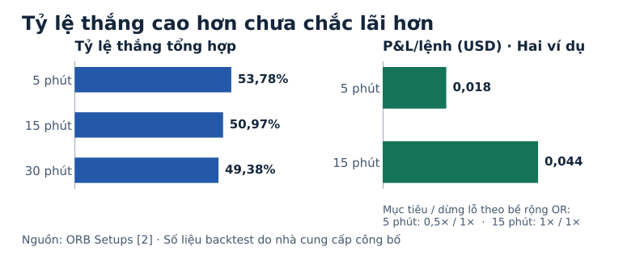

# Giao dịch khi giá phá vùng mở cửa (Opening Range Breakout, ORB)

Với ORB, bạn dựa vào mức cao nhất và thấp nhất trong vài phút đầu phiên. Khoảng giữa hai mức đó gọi là vùng mở cửa (OR). Ví dụ, với vùng 5 phút của cổ phiếu Mỹ, bạn đánh dấu đỉnh và đáy của năm nến 1 phút từ 09:30 đến 09:34, theo giờ New York. Đến 09:35, vùng đã hoàn tất. Lúc này mới xét mua (long) nếu giá vượt đỉnh, hoặc bán khống (short) nếu giá thủng đáy.

*Dữ liệu mô phỏng, không phải kết quả kiểm thử. Trong hình, giá đóng trên đỉnh vùng. Điểm dừng lỗ là đáy vùng. Mục tiêu +1R nghĩa là lãi bằng số tiền chấp nhận mất nếu giá chạm mức dừng lỗ ban đầu. Giá không chạm cả hai mức nên lệnh được đóng cuối phiên.*

## Vì sao nhìn vào những phút đầu phiên?

Khi sàn mở cửa, lệnh tích tụ qua đêm gặp thông tin mới. Nếu một bên vẫn mua hoặc bán mạnh sau khi vùng đã hình thành, giá có thể đi tiếp theo hướng phá vùng. Nhưng giá cũng có thể chỉ vượt biên trong chốc lát rồi quay lại. Đó là cú phá vỡ giả.

Khối lượng tương đối (RVOL) cho biết phiên này có sôi động hơn thường lệ không. Ví dụ, nếu 5 phút đầu hôm nay giao dịch 200.000 cổ phiếu, so với trung bình 100.000 cổ phiếu trong đúng 5 phút đầu các phiên trước, RVOL là 2. Chỉ số này giúp chọn mã để theo dõi. Nó không cho biết nên mua hay bán.

Vùng ngắn cho tín hiệu sớm nhưng dễ nhiễu. Vùng dài cho thêm thời gian quan sát. Đổi lại, mức dừng lỗ ở biên đối diện có thể xa hơn và giá còn ít thời gian hơn để đi tới mục tiêu trước khi đóng cửa.

## Hai cách vào lệnh

Trước hết, chọn phiên và độ dài vùng. Với cổ phiếu Mỹ, phiên chính bắt đầu lúc 09:30 theo múi giờ `America/New_York`. Chỉ lấy những nến nằm trọn trong vùng. Nến đầu mở đúng lúc bắt đầu phiên; nến cuối đóng đúng lúc vùng hoàn tất. Nếu nguồn dữ liệu gộp giao dịch đấu giá mở cửa vào nến 09:30, giữ phần đó trong vùng. Dùng nến 1 phút là cách đơn giản để đánh dấu đúng giờ.

### Cách 1: Chờ nến đóng ngoài vùng (Classic)

1. Đánh dấu đỉnh và đáy sau khi vùng hoàn tất.
2. Chờ một nến đóng trên đỉnh để xét mua, hoặc đóng dưới đáy để xét bán khống. Nếu chỉ có râu nến vượt biên mà giá đóng lại bên trong, bỏ qua.
3. Chọn trước cách thoát. Ví dụ ở hình trên: dừng lỗ ở biên đối diện, chốt lời ở +1R, hoặc thoát cuối phiên nếu chưa chạm mức nào. Đây là một cách minh họa, không phải quy tắc bắt buộc.

Một ví dụ trong tài liệu đầu vào dùng nến 5 hoặc 15 phút và yêu cầu khối lượng ít nhất bằng 1,5 lần mức trung bình phiên [3]. Chờ nến đóng giúp bỏ qua cú quét râu, nhưng giá vào có thể xa biên hơn.

### Cách 2: Đặt lệnh chờ kích hoạt tại biên (nghiên cứu [1])

1. Trước khi xếp hạng, lọc mã theo [giá mở cửa, khối lượng và biên độ dao động](#cac-con-so-ay-u-cua-nghien-cuu-1). Trong bản có RVOL, chia khối lượng của vùng hôm nay cho trung bình đúng khung giờ đó trong 14 phiên trước. Không lấy dữ liệu trước giờ mở cửa hoặc đưa hôm nay vào số bình quân. Trong các mã đủ điều kiện, chỉ lấy tối đa 20 mã có RVOL cao nhất trong nhóm đạt từ 1,0.
2. Nhìn màu của **cả nến mở cửa trên khung đang thử**. Ví dụ, với vùng 5 phút, đó là nến 09:30–09:35, không phải nến 1 phút đầu tiên. Nến xanh: đặt lệnh mua kích hoạt tại đỉnh vùng. Nến đỏ: đặt lệnh bán kích hoạt tại đáy vùng. Giá mở bằng giá đóng (doji): không đặt lệnh.
3. Đặt dừng lỗ cách **giá khớp** 10% ATR ngày, tính từ 14 phiên đã đóng. ATR là biên độ thực trung bình: ngoài đỉnh và đáy trong phiên, nó còn tính cả khoảng nhảy giá so với giá đóng cửa phiên trước. Không đặt mục tiêu chốt lời. Nếu chưa dừng lỗ, đóng vị thế cuối phiên.

*Dữ liệu mô phỏng, không phải kết quả kiểm thử. Cùng một chuỗi nến: cách 2 kích hoạt khi chạm biên; cách 1 chờ đến nến đóng ngoài vùng. Hình giả định các bộ lọc khác đã đạt.*

## Số liệu nói gì?

Hai nguồn dùng các giai đoạn, tập mã và quy tắc khác nhau. Một nguồn đo lợi suất của cả danh mục. Nguồn kia cộng lãi lỗ của các lượt giao dịch mô phỏng. Không so trực tiếp hai con số đó.

### Cổ phiếu Mỹ: cả cách lọc mã lẫn độ dài vùng đều đáng thử

Với vùng 5 phút, Sharpe tăng từ 0,48 lên 2,81 khi áp dụng cách chọn mã theo RVOL [1, Bảng 1–2]. Sharpe đo lợi suất vượt mức phi rủi ro so với mức biến động của lợi suất. Chênh lệch này không chỉ do ngưỡng RVOL: nghiên cứu còn giới hạn ở 20 mã và mức độ chạm trần đòn bẩy cũng thay đổi.

Giữ cách lọc RVOL mà đổi từ 5 sang 30 phút, Sharpe giảm từ 2,81 xuống 0,21 [1, Bảng 3]. Nghiên cứu chọn vùng 5 phút vì nó đứng đầu trong bốn độ dài thử trên cùng một tập dữ liệu. Kết quả chưa được [xác nhận ngoài mẫu](#cach-tinh-r-va-tieu-chi-ngoai-mau). Chưa thể kết luận vùng 5 phút sẽ luôn tốt nhất, hoặc RVOL quan trọng hơn độ dài vùng.

*Nguồn [1], Bảng 3 và Hình 4. Với vùng 5 phút, lãi lỗ trung bình sau hoa hồng là −0,02R khi RVOL dưới 1 và +0,08R khi RVOL trên 1. Hai thanh bên phải là hai nhóm RVOL, không phải so sánh có lọc với không lọc.*

### Thắng nhiều hơn chưa chắc kiếm nhiều hơn

Trong ORB Setups [2], vùng 5 phút có tỷ lệ thắng cao nhất khi gộp bốn cách đặt chốt lời và dừng lỗ. Vùng 15 phút lại dẫn về lãi lỗ trung bình: 0,0314 USD/lượt theo cách tính của nguồn.

| Vùng | Tỷ lệ thắng gộp |
| --- | ---: |
| 5 phút | 53,78% |
| 15 phút | 50,97% |
| 30 phút | 49,38% |

*Nguồn [2]. Bên trái gộp bốn cách thoát. Bên phải chỉ so hai ví dụ: dừng lỗ bằng cả bề rộng vùng, chốt lời ở nửa vùng với 5 phút và cả vùng với 15 phút.*

Trong hai ví dụ ở hình, lệnh 5 phút thắng 68,87% nhưng trung bình chỉ 0,018 USD/lượt. Lệnh 15 phút thắng 46,12% nhưng trung bình đạt 0,044 USD/lượt. Mục tiêu gần hơn dễ chạm hơn, nhưng mỗi lần thắng có thể mang về ít tiền hơn.

## Điều số liệu chưa trả lời

- **Khớp lệnh thật có thể kém hơn.** Hai nguồn không mô hình hóa chênh lệch giá mua và giá bán (spread) hay trượt giá, tức phần chênh giữa giá dự kiến và giá khớp. Nguồn [2] cũng không nêu hoa hồng hoặc làm rõ đơn vị lãi lỗ.
- **Nhiều lượt giao dịch không có nghĩa là nhiều quan sát độc lập.** Nguồn [2] là kết quả do nhà cung cấp công cụ lọc mã công bố. Nhiều lượt chung mã, phiên hoặc điểm vào. Không rõ danh sách mã có được lập theo từng thời điểm và có gồm mã đã hủy niêm yết không. Phần hỏi đáp còn nói 30 phút thắng nhiều hơn 5 phút trên tập 150.000+ lượt, trái với bảng chính, nhưng không giải thích khác biệt về mẫu.
- **Kết quả không ổn định ở mọi giai đoạn.** Với vùng 30 phút và chốt lời/dừng lỗ đều bằng cả vùng, tỷ lệ thắng theo tháng trong [2] dao động từ dưới 30% đến trên 60%. Kết quả cổ phiếu Mỹ cũng không chứng minh ORB hiệu quả trên hợp đồng tương lai hay ngoại hối.

## Tự kiểm tra trước khi dùng

1. **Xem tín hiệu trên biểu đồ.** Kiểm tra vùng có đúng giờ không. Tìm một cú quét râu và một nến đóng ngoài vùng. Đối chiếu xem mỗi cách vào lệnh phản ứng đúng chưa. Tín hiệu trên biểu đồ không phải giá khớp.
2. **Chốt cách mô phỏng.** Với cổ phiếu Mỹ, thử vùng 5, 15, 30 và 60 phút, mỗi vùng có và không lọc RVOL. Giữ cách khớp và thoát lệnh như nhau để biết yếu tố nào làm kết quả đổi. Ghi trước cách xử lý khi một nến chạm cả dừng lỗ lẫn chốt lời hoặc khi phiên đóng sớm. Chỉ dùng thông tin có sẵn lúc đặt lệnh.
3. **Đo lãi lỗ sau chi phí.** Tính hoa hồng, chênh lệch giá mua–bán và trượt giá cho cả hai chiều vào–ra. Với bán khống, kiểm tra khả năng vay cổ phiếu và phí vay. Tăng dần giả định trượt giá cho đến khi lãi lỗ ròng trung bình về 0. Ví dụ, nếu số liệu [2] tính trên mỗi cổ phiếu, chi phí khứ hồi 0,02 USD đã vượt 0,018 USD của ví dụ 5 phút.
4. **Chừa dữ liệu để kiểm tra sau.** Chọn và khóa cấu hình trên một đoạn dữ liệu. Sau đó chỉ đánh giá một lần trên đoạn kế tiếp chưa dùng để chọn tham số. Đó là kiểm tra ngoài mẫu (OOS). Báo riêng lệnh mua và lệnh bán, cùng số lệnh, tỷ lệ thắng, lãi lỗ ròng theo R và mức sụt giảm từ đỉnh vốn.

## Chi tiết để đối chiếu và triển khai

### Các con số đầy đủ của nghiên cứu [1]

Mô phỏng từ 01/2016 đến 12/2023, với 25.000 USD vốn đầu kỳ và hoa hồng 0,0035 USD/cổ phiếu. Ngay cả bản không lọc RVOL vẫn loại mã có giá mở cửa không quá 5 USD, khối lượng bình quân 14 phiên dưới 1 triệu cổ phiếu/ngày hoặc ATR ngày 14 phiên không quá 0,50 USD.

Nghiên cứu giới hạn mức lỗ tại điểm dừng ở 1% vốn phân bổ cho vị thế. Bài không nêu giới hạn 1% trên vốn toàn tài khoản. Trần đòn bẩy 4 lần của danh mục có thể làm rủi ro thấp hơn.

| Cấu hình | Tổng lợi suất | Lợi suất năm (IRR) | Sharpe | Hit ratio |
| --- | ---: | ---: | ---: | ---: |
| 5 phút, không lọc RVOL | 29% | 3,2% | 0,48 | 41,4% |
| Nắm giữ S&P 500 | 198% | 14,2% | 0,78 | 54,9% |
| 5 phút, có lọc RVOL | 1.637% | 41,6% | 2,81 | 48,4% |
| 15 phút, có lọc RVOL | 272% | 17,4% | 1,43 | 44,7% |
| 30 phút, có lọc RVOL | 21% | 2,3% | 0,21 | 42,4% |
| 60 phút, có lọc RVOL | 39% | 4,1% | 0,40 | 42,3% |
| Chia đều bốn danh mục có RVOL (COMBO) | 234% | 15,8% | 1,99 | 47,3% |

Bài [1] không ghi rõ cột “Hit ratio” trong bảng tính theo ngày hay theo lệnh. Không so trực tiếp cột này với tỷ lệ lệnh thắng trong [2].

### Số liệu bổ sung từ ORB Setups [2]

Mẫu gồm 1.178.668 lượt trên 614 mã trong 311 phiên. Nguồn dùng dữ liệu nến 1 phút từ 12/2024 đến 03/2026.

| Vùng | Bề rộng trung bình | Không chạm chốt lời hoặc dừng lỗ trước cuối phiên |
| --- | ---: | ---: |
| 5 phút | 0,76 USD | 3,34% |
| 30 phút | 1,04 USD | 12,76% |

Vùng 30 phút có tổng lãi lỗ mô phỏng cao nhất (13.270,96 USD). Đây không phải số liệu về lợi suất danh mục. Riêng vùng 5 phút, khi đổi chốt lời/dừng lỗ từ 0,5/1 lần bề rộng sang 1/0,5 lần, tỷ lệ thắng giảm từ 68,87% còn 39,12%.

Lệnh bán khống thắng thường xuyên hơn trong mẫu này. Tuy nhiên, lãi lỗ trung bình nghiêng về lệnh mua: 0,031 so với 0,011 USD/lượt ở vùng 5 phút, và 0,041 so với 0,022 USD/lượt ở vùng 15 phút. Không biết rủi ro từng lệnh thì chưa thể so hai chiều theo R.

### Cách tính R và tiêu chí ngoài mẫu

- **1R** là khoảng cách tuyệt đối từ giá khớp tới dừng lỗ ban đầu, nhân số lượng giao dịch và hệ số hợp đồng. Hệ số này bằng 1 với cổ phiếu. Giữ nguyên 1R của mỗi lệnh dù sau đó đổi mức dừng lỗ. Để tính kỳ vọng ròng, chia lãi lỗ sau chi phí của từng lệnh cho R của lệnh đó rồi lấy trung bình. Tính cả lệnh thoát cuối phiên.
- Nếu số liệu [2] tính trên mỗi cổ phiếu, lấy lãi lỗ trung bình chia cho bề rộng vùng trung bình để ước lượng. Hai ví dụ là 0,018 ÷ 0,76 ≈ 0,024R và 0,044 ÷ 0,94 ≈ 0,047R. Không nhầm phép chia này với trung bình tính từ rủi ro riêng của từng lệnh.
- Chốt tiêu chí trước. Ví dụ: ít nhất 300 lệnh ngoài mẫu trong ít nhất 12 tháng, kỳ vọng ròng dương và cận dưới của khoảng tin cậy 95% cũng dương. Để ước lượng khoảng tin cậy, lấy mẫu lại theo cả khối ngày giao dịch (bootstrap), không bốc từng lệnh riêng lẻ.
- Có thể lặp lại việc khóa cấu hình rồi kiểm tra trên đoạn kế tiếp khi dịch cửa sổ thời gian (walk-forward). Không chọn cấu hình thắng trên dữ liệu ngoài mẫu rồi dùng khoảng tin cậy thông thường trên chính dữ liệu đó. Nếu so nhiều cấu hình trên cùng đoạn, báo tất cả và dùng phương pháp hiệu chỉnh cho nhiều phép so sánh. Kiểm tra xem các tham số gần cấu hình đã chọn có cho kết quả tương tự không.

### Các biến thể khác để thử

Đây là các ý tưởng từ tài liệu thực hành, không phải kết quả đối chứng của hai nguồn trên.

- **Chờ thử lại biên (ORB Retest).** Đợi giá quay về mép vùng và có nến xác nhận đi tiếp. Có thể đặt dừng lỗ sau nến thử lại. Điểm dừng có thể gần hơn, nhưng bạn sẽ bỏ qua cú chạy không quay lại [4].
- **Lọc theo xu hướng (Trend-Filtered ORB).** Apex dùng đường trung bình lũy thừa (EMA) trên biểu đồ 15 phút. Forex Tester dùng giá trung bình gia quyền theo khối lượng (VWAP) cùng EMA 20 kỳ. Bộ lọc có thể chậm khi giá đảo chiều [4–5].
- **Theo hướng khoảng trống giá (Gap-and-Go ORB).** Chờ nến phá vùng theo hướng khoảng trống qua đêm nếu khoảng trống lớn hơn ATR gần nhất. Nếu giá sớm lấp khoảng trống, giả thuyết đi tiếp yếu đi. Không mặc định giảm vị thế 50% [4].
- **Phá vỡ thất bại (Failed ORB).** Nếu nến đóng trở lại trong vùng, thoát lệnh thuận phá vỡ nếu có. Nếu muốn thử vào ngược hướng về biên kia, coi đó là tín hiệu riêng: giá vẫn có thể quay lại hướng phá vỡ ban đầu [6].

### Thử trên thị trường khác

Các mốc dưới đây chỉ là giả thuyết chưa kiểm định.

- **Hợp đồng tương lai ES, NQ, MNQ:** Thử vùng 15 phút từ 09:30 New York, kết hợp VWAP/EMA hoặc chờ thử lại biên. Bỏ qua nếu vùng quá rộng so với ATR ngày. Chốt ngưỡng trước khi thử.
- **Ngoại hối và vàng XAUUSD:** Thử vùng 15–30 phút đầu phiên London hoặc New York. Đây là giờ quy ước, không phải giờ đấu giá mở cửa tập trung. Có thể thử đợi giá quay lại biên hoặc quét qua mức giá rồi quay đầu (liquidity sweep). Số lần giá cập nhật (tick volume) của một nguồn không phải khối lượng toàn thị trường. Không đọc RVOL tính từ số đó như RVOL cổ phiếu.

### Ghi chú khi viết Pine Script

- Biểu đồ một mã chỉ kiểm tra tín hiệu trên mã đó. Nó không tái tạo danh mục 20 mã có RVOL cao nhất, trần đòn bẩy 4 lần hay danh sách mã lịch sử không thiên lệch. Chốt giờ và múi giờ, lưu khối lượng cùng cửa sổ 14 phiên trước. Chỉ khóa vùng và RVOL sau khi cửa sổ hoàn tất.
- Lệnh chờ có thể khớp tại giá mở nến nếu giá nhảy qua mức đặt. Nếu cùng nến chạm cả mục tiêu và dừng lỗ, dùng dữ liệu khung nhỏ hơn hoặc Bar Magnifier để xem thứ tự nếu có. Nếu không, dùng quy tắc bảo thủ. Chốt cách thoát cuối phiên, kể cả phiên rút ngắn.
- Khi lấy ATR ngày qua `request.security`, chỉ dùng dữ liệu ngày đã đóng. Nếu dùng `lookahead_on` trên khung cao hơn, phải lấy giá trị của nến trước bằng `[1]`.
- `request.security_lower_tf()` có thể dựng vùng 5 phút từ các nến nhỏ hơn. Nhưng trong mô phỏng mặc định trên biểu đồ 15 phút, mã chỉ chạy khi nến 09:30–09:45 đóng. Nó không thể đặt lệnh lúc 09:35 và có thể bỏ lỡ cú phá vùng trước 09:45. Muốn đặt ở 09:35, dùng biểu đồ có nến đóng đúng mốc đó, chẳng hạn nến 1 phút.

## Nguồn

- Tài liệu đầu vào: *Đánh giá hiệu quả các phương pháp Opening Range Breakout (ORB) trên thị trường* (HTML do người dùng cung cấp).
- [1] Zarattini, Barbon & Aziz (2024), [*A Profitable Day Trading Strategy For The U.S. Equity Market*](https://concretumgroup.com/a-profitable-day-trading-strategy-for-the-u-s-equity-market/), Swiss Finance Institute Research Paper No. 24-98, §2.1, §3–5, Hình 4 và Bảng 1–3 (Bảng 3 ở §5).
- [2] ORB Setups, [*5 vs 15 vs 30 Minute Opening Range Breakout: 1.17M Trades Backtest*](https://orbsetups.com/research/5-minute-vs-15-minute-vs-30-minute-opening-range-which-timeframe-has-the-best-win-rate/).
- [3] JournalPlus, [*Opening Range Breakout Strategy Guide*](https://journalplus.co/strategies/opening-range-breakout).
- [4] Apex Trader Funding, [*Opening Range Breakout (ORB) Strategy for Futures (5 Setups)*](https://apextraderfunding.com/resources/futures-trading/opening-range-breakout-strategy/).
- [5] Forex Tester, [*Opening Range Breakout (ORB) Trading Strategy*](https://forextester.com/blog/opening-range-breakout-trading-strategies/).
- [6] The Chart Guys, [*ORB Trading Strategy: Mastering the Opening Range Breakout*](https://www.chartguys.com/articles/orb-trading-strategy).
