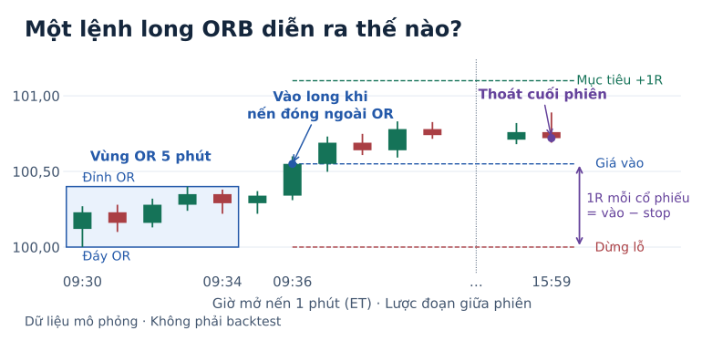
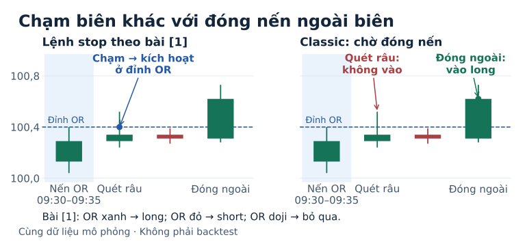

# Opening Range Breakout (ORB): bằng chứng và cách kiểm chứng

**Kết luận:** Với cổ phiếu Mỹ, cả cách chọn mã theo khối lượng tương đối (RVOL) lẫn độ dài vùng mở cửa đều ảnh hưởng lớn đến kết quả mô phỏng; bằng chứng không cho phép xếp yếu tố này trên yếu tố kia. Trong một mẫu khác, 5 phút dẫn về tỷ lệ thắng nhưng 15 phút dẫn về P&L trung bình. Không nên chọn cấu hình chỉ bằng tỷ lệ thắng hoặc suy rộng sang futures và Forex.

## Vì sao ORB có thể hiệu quả?

**Vùng mở cửa (OR)** là khoảng từ low thấp nhất đến high cao nhất của các nến nằm trọn trong `[giờ mở phiên, giờ mở phiên + N phút)`. Với cổ phiếu Mỹ, neo vào 09:30 `America/New_York`, chỉ dùng phiên chính, tính cả giao dịch đấu giá mở cửa nếu nguồn gộp vào nến 09:30. Dùng nến 1 phút hoặc khung chia hết `N` và khớp mốc mở phiên; chỉ xét tín hiệu sau khi vùng hoàn tất. Giả thuyết là thông tin mới và nhu cầu giao dịch tích tụ có thể tạo đà tiếp diễn; cú xuyên biên rồi quay lại cho thấy phá vỡ không đồng nghĩa có xu hướng.

Khối lượng tương đối (Relative Volume, **RVOL**) giúp phân biệt một phiên thực sự thu hút giao dịch với một phiên chỉ có vẻ sôi động vì đang ở giờ mở cửa. Mẫu số nên là khối lượng bình quân **cùng cửa sổ thời gian** ở các phiên trước, không phải khối lượng cả ngày. RVOL giúp chọn mã để theo dõi, không tự xác định hướng lệnh và không bảo đảm cú phá vỡ sẽ tiếp diễn.

Vùng ngắn cho tín hiệu sớm nhưng dễ nhiễu; vùng dài cho thêm thời gian quan sát nhưng nếu cùng đóng cuối phiên, lệnh có ít thời gian hơn để đạt mục tiêu và stop theo biên có thể xa hơn. Để so sánh, lấy **1R = |giá khớp vào − stop ban đầu| × khối lượng × hệ số hợp đồng** (hệ số 1 cho cổ phiếu). Giữ mẫu số cố định; kỳ vọng ròng là trung bình `P&L sau chi phí / R` trên từng lệnh, kể cả lệnh thoát cuối phiên.

*Minh họa mô phỏng, không phải backtest. Giá đóng trên đỉnh vùng OR, dừng lỗ đặt ở đáy vùng. Nếu giá không chạm dừng lỗ hoặc mục tiêu +1R, lệnh được đóng cuối phiên. Mục tiêu +1R là lựa chọn minh họa, không phải quy tắc của [1].*

## Hai nguồn dữ liệu trả lời hai câu hỏi khác nhau

### 1. RVOL có giúp chọn cổ phiếu tốt hơn?

Zarattini, Barbon & Aziz [1, bảng 1–3] mô phỏng danh mục cổ phiếu Mỹ từ 01/2016 đến 12/2023, vốn đầu kỳ 25.000 USD, hoa hồng 0,0035 USD/cổ phiếu.

| Cấu hình | Tổng lợi suất | IRR năm | Sharpe | Hit ratio [1] |
| --- | ---: | ---: | ---: | ---: |
| ORB 5 phút, không lọc RVOL | 29% | 3,2% | 0,48 | 41,4% |
| Nắm giữ S&P 500 | 198% | 14,2% | 0,78 | 54,9% |
| ORB 5 phút + RVOL | 1.637% | 41,6% | 2,81 | 48,4% |
| ORB 15 phút + RVOL | 272% | 17,4% | 1,43 | 44,7% |
| ORB 30 phút + RVOL | 21% | 2,3% | 0,21 | 42,4% |
| ORB 60 phút + RVOL | 39% | 4,1% | 0,40 | 42,3% |
| COMBO (chia đều bốn danh mục RVOL) | 234% | 15,8% | 1,99 | 47,3% |

**Quy tắc [1, §2.1, §4–5]:** Lọc giá mở cửa > 5 USD, volume bình quân 14 phiên ≥ 1 triệu cổ phiếu/ngày và ATR ngày 14 phiên > 0,50 USD. Nhánh RVOL lấy volume của chính cửa sổ OR hôm nay chia cho trung bình cùng cửa sổ 14 phiên trước (không dùng pre-market hay volume hôm nay trong mẫu số); lấy tối đa 20 mã có RVOL cao nhất trong nhóm ≥ 1,0. Nến đầu tiên của khung OR xanh → buy stop tại OR high; đỏ → sell stop tại OR low; doji (open = close) → bỏ qua. Stop cách **giá khớp** 10% ATR ngày 14 phiên đã đóng; không có target, đóng cuối phiên. Bài gốc mô tả mức lỗ khi chạm stop là tối đa 1% vốn phân bổ cho vị thế đó, không nêu là 1% vốn toàn tài khoản; trần đòn bẩy danh mục 4× có thể làm mức rủi ro thấp hơn.

**Cách đọc:** Hình 4 [1, §3] báo cáo P&L trung bình 5 phút sau hoa hồng là **−0,02R** khi RVOL < 1 và **+0,08R** khi RVOL > 1. Chênh lệch Sharpe 0,48 → 2,81 còn gộp tác động của ngưỡng RVOL, cắt top 20 và mức độ chạm trần đòn bẩy. Ngay khi giữ tiêu chí chọn theo RVOL, đổi từ 5 sang 30 phút làm Sharpe giảm 2,81 → 0,21. Khung 5 phút đứng đầu sau khi so bốn khung **trên cùng mẫu**, không phải lựa chọn đã xác nhận ngoài mẫu.

*Nguồn [1], Bảng 3 và Hình 4. Bên trái là Sharpe danh mục có lọc RVOL; bên phải là P&L mỗi lệnh ở hai nhóm RVOL, không phải phép so sánh có lọc và không lọc.*

### 2. Độ dài vùng và quy tắc thoát ảnh hưởng thế nào?

ORB Setups [2] báo cáo 1.178.668 lượt giao dịch mô phỏng trên 614 mã, dùng dữ liệu nến 1 phút từ 12/2024 đến 03/2026. Tỷ lệ thắng tổng hợp gộp bốn tổ hợp chốt lời/dừng lỗ; không phải tỷ lệ thắng của một cấu hình duy nhất.

| Vùng | Tỷ lệ thắng tổng hợp | Kết quả nổi bật trong mẫu |
| --- | ---: | --- |
| 5 phút | 53,78% | Vùng trung bình rộng 0,76 USD; 3,34% lượt không chạm mục tiêu hoặc dừng lỗ trước cuối phiên. |
| 15 phút | 50,97% | P&L trung bình gộp cao nhất: 0,0314 USD/lượt; không thể quy đổi chính xác sang R nếu thiếu rủi ro từng lệnh. |
| 30 phút | 49,38% | Tổng lãi/lỗ mô phỏng cao nhất: 13.270,96 USD; vùng rộng trung bình 1,04 USD và 12,76% lượt chưa chạm mục tiêu hoặc dừng lỗ trước cuối phiên. |

Với **stop bằng cả bề rộng vùng**, 15 phút đặt target bằng cả vùng đạt 46,12% và 0,044 USD/lượt (xấp xỉ **0,047R**); 5 phút đặt target bằng nửa vùng đạt 68,87% nhưng chỉ 0,018 USD/lượt (xấp xỉ **0,024R**). Đây là phép chia theo bề rộng trung bình 0,94 và 0,76 USD, giả định P&L nguồn tính trên một cổ phiếu; **không** phải trung bình P&L/R từng lệnh. Giữ nguyên khung 5 phút, đổi từ target/stop 0,5×/1× sang 1×/0,5× làm tỷ lệ thắng giảm từ 68,87% xuống 39,12%: thay quy tắc thoát có thể đổi kết luận chỉ dựa trên tỷ lệ thắng.

*Nguồn [2]. Bên trái gộp các quy tắc thoát; bên phải chỉ so sánh hai cấu hình cụ thể, không phải P&L trung bình của tất cả cấu hình theo từng khung.*

Theo [2], short thắng thường xuyên hơn nhưng long có P&L USD trung bình cao hơn: 0,031 so với 0,011 ở 5 phút và 0,041 so với 0,022 ở 15 phút. Thiếu rủi ro từng lệnh nên không thể kết luận bên nào tốt hơn theo R. Khung 30 phút với target/stop bằng cả vùng cũng dao động từ dưới 30% đến trên 60% tỷ lệ thắng theo tháng.

**Giới hạn [2]:** Đây là backtest do nhà cung cấp scanner công bố; tập 614 mã có rủi ro thiên lệch chọn mẫu và sống sót vì không rõ danh sách có theo từng thời điểm và gồm mã đã hủy niêm yết hay không. FAQ nói 30 phút thắng cao hơn 5 phút (dẫn tập 150.000+ lượt), ngược với bảng chính và không giải thích khác biệt mẫu. Trong 311 phiên, nhiều lượt dùng chung mã, ngày hoặc điểm vào; không coi hơn một triệu lượt là quan sát độc lập. Hai nguồn không mô hình hóa spread hay trượt giá theo phương pháp công bố; [2] cũng không nêu hoa hồng hay làm rõ đơn vị P&L. P&L cộng dồn ở [2] không phải lợi suất danh mục như [1].

## Năm biến thể: điều gì được đánh đổi?

Các cơ chế sau là ví dụ thực hành [3–6], không phải năm nhánh đã được so sánh đối chứng trong [1] hoặc [2].

*Minh họa mô phỏng, không phải backtest. Với nến OR xanh, lệnh buy stop theo [1] kích hoạt khi giá chạm đỉnh OR; khi nến OR là doji thì không đặt lệnh. Classic chỉ xét tín hiệu tại nến đóng ngoài vùng, giả sử các bộ lọc khác đã đạt.*

| Biến thể | Tín hiệu vào lệnh | Lợi thế kỳ vọng và điểm yếu |
| --- | --- | --- |
| **Classic Breakout** | Ví dụ HTML: nến 5/15 phút đóng ngoài biên, volume ≥ 1,5× mức trung bình phiên [3]. | Bắt cú chạy thẳng nhưng có thể vào xa biên hoặc gặp phá vỡ giả; khác lệnh stop tại biên của [1]. |
| **ORB Retest** | Chờ giá quay lại mép vùng và đóng nến xác nhận tiếp diễn; có thể đặt stop sau nến retest [4]. | Điểm vô hiệu gần hơn, nhưng bỏ lỡ cú chạy không quay lại. |
| **Trend-Filtered ORB** | Apex [4]: lọc theo EMA trên chart 15 phút. Forex Tester [5]: VWAP kết hợp EMA 20 kỳ. | Lọc tín hiệu ngược xu hướng; có thể chậm khi giá đảo chiều. |
| **Gap-and-Go ORB** | Gap qua đêm lớn hơn ATR gần nhất; chờ nến phá vùng theo hướng gap [4]. | Có thể tận dụng đà sau tin; gap lấp sớm làm suy yếu giả thuyết. Không mặc định giảm vị thế 50%. |
| **Failed ORB** | Nến đóng lại trong vùng sau cú phá: thoát lệnh thuận phá vỡ nếu có; kiểm định lệnh ngược hướng về biên đối diện riêng [6]. | Có thể hưởng lợi khi phe theo cú phá phải thoát; có thể thua thêm nếu giá quay lại hướng cũ. |

## Kiểm chứng trước khi triển khai

1. **Tách yếu tố và thị trường.** Với cổ phiếu Mỹ, so lưới 5/15/30/60 phút × có/không lọc RVOL, giữ quy tắc khớp và thoát cố định. **Giả thuyết chưa kiểm định:** ES/NQ/MNQ dùng vùng 15 phút từ 09:30 ET, thử VWAP/EMA hoặc Retest và bỏ qua nếu vùng quá rộng so với ATR ngày (chốt ngưỡng trước). Forex/XAUUSD thử vùng 15–30 phút đầu London/New York với Retest hoặc Liquidity Sweep; tick volume của một nguồn không đại diện volume toàn thị trường, không dùng RVOL đó như RVOL cổ phiếu.
2. **Đo độ nhạy chi phí.** Mô phỏng hoa hồng, spread, trượt giá theo tick mỗi chiều và phí/khả năng vay cổ phiếu khi short. Với hoa hồng và spread đã cố định, tăng trượt giá và báo mức hòa vốn (kỳ vọng ròng = 0). Ví dụ, nếu P&L nguồn [2] là trên mỗi cổ phiếu, chi phí 0,02 USD khứ hồi đã vượt mức 0,018 USD của cấu hình 5 phút nêu trên.
3. **Chốt tiêu chí ngoài mẫu (OOS) trước khi chạy.** Ví dụ: ≥ 300 lệnh OOS trong ≥ 12 tháng, kỳ vọng ròng > 0 và cận dưới khoảng tin cậy bootstrap 95% > 0 (lấy lại mẫu theo khối ngày giao dịch, không theo từng lệnh). Dùng walk-forward: chọn và khóa cấu hình trên đoạn trong mẫu, đánh giá một lần trên đoạn OOS kế tiếp chưa dùng, rồi lăn cửa sổ. Không chọn cấu hình thắng theo OOS rồi dùng khoảng tin cậy thông thường trên chính đoạn đó: cách này không tính đến thiên lệch chọn cấu hình. Nếu so nhiều cấu hình trên cùng đoạn OOS, báo cáo tất cả và hiệu chỉnh đa so sánh; kiểm tra độ ổn định ở tham số lân cận.

## Ghi chú triển khai Pine Script

- Chart đơn mã chỉ kiểm tra quy tắc của mã đó; không tái tạo danh mục top 20 RVOL, trần 4× toàn danh mục hay tập mã lịch sử không thiên lệch. Khóa OR/RVOL khi cửa sổ hoàn tất; dùng phiên/múi giờ rõ ràng và lưu volume cùng cửa sổ của 14 phiên trước.
- Tách marker khỏi giá khớp: lệnh stop có thể khớp ở giá mở nến nếu gap qua mức; nếu stop và target cùng nến, dùng dữ liệu khung thấp/Bar Magnifier khi có hoặc quy tắc bảo thủ. Chốt thoát cuối phiên, kể cả phiên rút ngắn.
- Với `request.security` lấy ATR ngày, chỉ dùng ATR của nến ngày đã đóng (biểu thức lệch `[1]` nếu dùng `lookahead_on` trên khung cao); không dùng `lookahead_on` với dữ liệu chưa lệch. `request.security_lower_tf()` có thể dựng OR từ các nến nhỏ hơn, nhưng strategy mặc định chỉ tính khi nến chart đóng. Trên chart 15 phút, OR 5 phút kết thúc lúc 09:35 nhưng strategy chỉ có thể đặt lệnh lúc 09:45, bỏ lỡ các cú phá trước đó. Muốn đặt lệnh lúc 09:35 trong backtest mặc định, dùng chart có nến đóng tại mốc đó (ví dụ 1 phút).

## Nguồn

- Tài liệu đầu vào: *Đánh giá hiệu quả các phương pháp Opening Range Breakout (ORB) trên thị trường* (HTML do người dùng cung cấp).
- [1] Zarattini, Barbon & Aziz (2024), [*A Profitable Day Trading Strategy For The U.S. Equity Market*](https://concretumgroup.com/a-profitable-day-trading-strategy-for-the-u-s-equity-market/), Swiss Finance Institute Research Paper No. 24-98, §2.1, §3–5, Hình 4 và Bảng 1–3 (Bảng 3 ở §5).
- [2] ORB Setups, [*5 vs 15 vs 30 Minute Opening Range Breakout: 1.17M Trades Backtest*](https://orbsetups.com/research/5-minute-vs-15-minute-vs-30-minute-opening-range-which-timeframe-has-the-best-win-rate/).
- [3] JournalPlus, [*Opening Range Breakout Strategy Guide*](https://journalplus.co/strategies/opening-range-breakout).
- [4] Apex Trader Funding, [*Opening Range Breakout (ORB) Strategy for Futures (5 Setups)*](https://apextraderfunding.com/resources/futures-trading/opening-range-breakout-strategy/).
- [5] Forex Tester, [*Opening Range Breakout (ORB) Trading Strategy*](https://forextester.com/blog/opening-range-breakout-trading-strategies/).
- [6] The Chart Guys, [*ORB Trading Strategy: Mastering the Opening Range Breakout*](https://www.chartguys.com/articles/orb-trading-strategy).
