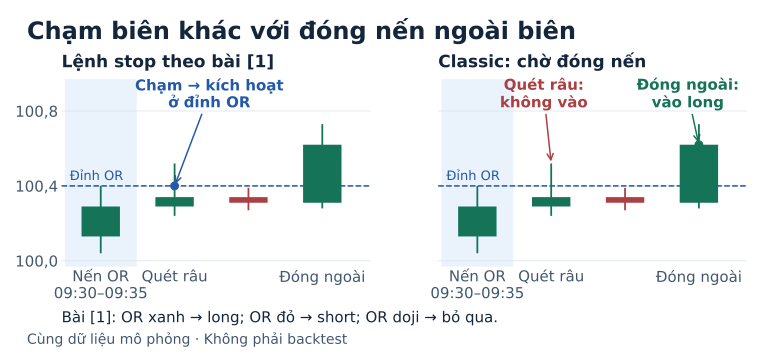

# Dùng chỉ báo ORB để xem điểm vào lệnh

Chỉ báo này đánh dấu điểm vào lệnh (entry) để bạn kiểm tra quy tắc bằng mắt. Nó **hiện cả entry trong quá khứ** trên những nến TradingView đã tải.

Chỉ báo không đặt lệnh, không tính lãi lỗ và không chứng minh chiến lược có lợi nhuận. Mục tiêu là kiểm tra điểm vào trước khi viết bản kiểm thử chiến lược (`strategy`).

## Vì sao cần xem trước trên biểu đồ?

Cùng một cú phá vùng, hai cách vào có thể cho tín hiệu khác nhau. Nếu hiểu sai điểm này, kết quả kiểm thử sau đó sẽ không còn đúng ý bạn.

*Dữ liệu mô phỏng, không phải kết quả kiểm thử. Paper xét giá chạm biên; Classic chờ nến đóng ngoài biên.*

Đọc [giải thích phương pháp ORB](opening-range-breakout.md) nếu bạn muốn xem bằng chứng và giới hạn của nghiên cứu.

## Thêm chỉ báo vào TradingView

1. Mở [mã Pine](https://github.com/ntduong1998vn/trader-research/blob/main/pine/orb-entry-indicator.pine), chọn **Raw** rồi sao chép toàn bộ.
2. Mở biểu đồ một cổ phiếu Mỹ, chẳng hạn AAPL. Chọn **nến thường, khung 1 phút**.
3. Mở **Pine Editor**, tạo một indicator mới, xóa nội dung mẫu rồi dán mã đã chép.
4. Bấm **Save**, sau đó **Add to chart**. Có thể tìm các nút này trong menu của Pine Editor.
5. Mở cài đặt chỉ báo. Lần đầu giữ **Classic**, vùng **5 phút** và tắt lọc RVOL để kiểm tra giá trước.

Mặc định, phiên là 09:30–16:00 theo `America/New_York`, từ thứ Hai đến thứ Sáu. Múi giờ hiển thị của biểu đồ không đổi cách tính.

**Bản đầu chỉ hỗ trợ nến thường 1 phút.** Khung khác hoặc nến Heikin Ashi/Renko sẽ báo lỗi và ngừng chạy.

## Mỗi phiên chỉ báo làm gì?

1. Ghi đỉnh, đáy và khối lượng của các nến từ 09:30 đến trước 09:35.
2. Khi nến 09:34 đóng, chốt vùng mở cửa (opening range, OR). Biên không dịch theo những nến sau.
3. Từ nến 09:35, chờ điều kiện vào của chế độ bạn chọn.
4. Đánh dấu entry sau khi nến tín hiệu đóng. Vẽ giá tham chiếu, dừng lỗ và mục tiêu nếu có.
5. Theo dõi chạm các mức giá hoặc hết phiên. Sang phiên mới thì làm lại.

Hộp OR lớn dần theo các nến đã đóng, không theo từng thay đổi giá trong nến đang chạy.

### Classic: chờ nến đóng ngoài vùng

Ví dụ vùng có đỉnh **100**, đáy **99**:

- Nến có râu lên 100,20 nhưng đóng 99,90: không vào.
- Nến trước đóng không quá 100, nến này đóng 100,10: đánh dấu mua.
- Nếu nến trước đã đóng trên 100, không đánh dấu mua lặp lại.

Điều kiện bán đối xứng: giá đóng từ trên hoặc bằng đáy chuyển xuống dưới đáy.

Giá tham chiếu là giá đóng của nến tín hiệu. Đây không phải giá khớp được bảo đảm.

Dừng lỗ mặc định ở biên đối diện. Với ví dụ trên, dừng lỗ là 99; khoảng rủi ro ban đầu (**1R**) là 1,10 đơn vị giá.

Mục tiêu mặc định cách giá vào 1R, tức 101,20. Chỉ xét stop và target từ nến sau entry vì Classic vào ở giá đóng.

Chỉ báo không mở entry Classic ở nến cuối phiên: lúc đó không còn thời gian theo dõi sau giá đóng.

### Paper: chờ giá chạm biên theo màu nến OR

Paper lấy màu của **cả vùng OR**, không phải màu nến 1 phút đầu tiên.

Ví dụ OR dài 5 phút: so giá mở nến 09:30 với giá đóng nến 09:34.

| Màu nến OR | Điều kiện chờ |
| --- | --- |
| Đóng cao hơn mở | Chỉ mua khi giá chạm đỉnh OR |
| Đóng thấp hơn mở | Chỉ bán khi giá chạm đáy OR |
| Đóng bằng mở, gọi là doji | Bỏ cả phiên |

Không dùng dung sai “gần bằng” để xác định doji.

Nếu đỉnh OR là 100 nhưng nến kế tiếp mở ở 100,30, giá vào tham chiếu là 100,30. Không giả định mua được tại 100.

Paper dùng dừng lỗ cách giá vào **10% ATR ngày (14)**. ATR là biên độ thực trung bình; chỉ lấy các ngày đã đóng.

Ví dụ ATR là 2 thì khoảng dừng lỗ là 0,20. Mức giá được làm tròn theo bước giá của mã, tối thiểu một bước.

Paper không có mục tiêu chốt lời và luôn giới hạn một entry mỗi phiên. Nếu chưa dừng lỗ, đánh dấu đóng cuối phiên.

**Lưu ý thời điểm:** Paper xét nến có chạm biên, nhưng mũi tên và cảnh báo chỉ xuất hiện khi nến ấy đóng. Nó không gửi lệnh dừng mua/bán thật.

## Đọc các dấu trên biểu đồ

| Dấu | Ý nghĩa |
| --- | --- |
| Hộp xanh, hai biên xanh | Vùng mở cửa |
| Tam giác `L` / `S` | Entry mua / bán |
| Đường xám | Giá entry tham chiếu |
| Đường đỏ / xanh lá | Dừng lỗ / mục tiêu |
| `SL` / `TP` | Chạm dừng lỗ / mục tiêu |
| `EOD` | Đóng ở giá đóng nến cuối phiên đã chọn |
| Hình thoi cam `?` | Không xác định được thứ tự chạm giá trong nến |
| Hình thoi xám `DATA` | Thiếu dữ liệu khi đang theo dõi lệnh; không đoán giá thoát |

Đường mức giá kết thúc khi chỉ báo ngừng theo dõi lệnh. Nến entry vẫn có mũi tên kể cả khi chính nến đó bị đánh dấu `?`.

**Không tự chọn kết quả thắng/thua cho nến mơ hồ.** Chẳng hạn một nến Classic chạm cả stop và target, hoặc nến Paper vừa chạm entry vừa chạm stop.

Nếu Paper vào ngay giá mở nến, thứ tự đã rõ: mở lệnh trước rồi mới xét stop. Nếu giá đóng đã vượt qua stop sau entry, cũng xác nhận được stop.

Một lệnh đã mở nhảy qua stop/target lấy giá mở làm tham chiếu thoát.

Sau dấu `?`, chỉ báo ngừng theo dõi lượt đó. Đây không phải kết quả giao dịch đã biết.

## Các cài đặt cần dùng

| Cài đặt | Cách dùng |
| --- | --- |
| Cách vào | Bắt đầu bằng Classic; chuyển Paper để đối chiếu chạm biên |
| Số phút đầu phiên | Chọn 5, 15, 30 hoặc 60 |
| Chiều cho phép | Cả hai, chỉ mua hoặc chỉ bán |
| Classic: tối đa 1 entry / phiên | Bật mặc định; tắt để xét cú cắt biên mới sau khi lượt trước kết thúc |
| Phiên liên tục | Một khoảng giờ, mặc định `0930-1600` |
| Ngày | `23456` là T2–T6; `1234567` là cả tuần |
| Múi giờ | Dùng tên IANA như `America/New_York`, tự đổi giờ mùa hè |
| Classic: dừng lỗ | Biên đối diện hoặc 10% ATR ngày (14) |
| Classic: vẽ mục tiêu | Tắt để chỉ theo dõi stop hoặc cuối phiên |
| Classic: mục tiêu theo R | Mặc định 1; không ảnh hưởng Paper |
| Số hộp OR giữ lại | Mặc định 40; chỉ giới hạn hộp, không giới hạn mũi tên lịch sử |

Tắt giới hạn Classic không cho phép nhiều lệnh cùng lúc. Sau khi thoát, cần một cú cắt biên mới ở nến khác.

### Khi nào bật lọc khối lượng?

Bật sau khi đã kiểm tra đúng vùng và entry. Khối lượng tương đối (relative volume, RVOL) so khối lượng OR hôm nay với các phiên trước.

**RVOL = Khối lượng OR hôm nay ÷ Khối lượng OR trung bình của N phiên hợp lệ trước.**

Mặc định N là 14. Ví dụ 200.000 cổ phiếu hôm nay so với trung bình 100.000 cổ phiếu thì RVOL bằng 2.

Với ngưỡng 1,5, phiên này được xét entry. Nếu bật lọc mà chưa đủ lịch sử, thiếu volume hoặc RVOL dưới ngưỡng thì không có entry.

Phiên hợp lệ phải có đủ các nến OR và tổng volume dương. Phiên hiện tại chỉ được thêm vào lịch sử **sau khi** tính RVOL.

Đây là lọc **một mã đang xem**, không chọn top 20 cổ phiếu như bài nghiên cứu. Volume của Forex có thể chỉ là số lần giá thay đổi, không phải khối lượng giao dịch.

## Giới hạn cần biết trước khi đối chiếu

- Lịch sử chỉ gồm các nến TradingView đã tải. Không có cam kết xem được bao nhiêu tháng.
- Entry dùng dấu vẽ theo nến, không dùng đối tượng nhãn có giới hạn số lượng thấp. Hộp cũ có thể bị xóa.
- Không sửa được dữ liệu do nhà cung cấp điều chỉnh về sau.
- Bảng trạng thái chỉ mô tả phiên gần nhất; xem phiên cũ bằng mũi tên và cửa sổ dữ liệu (Data Window).

Nếu dữ liệu bắt đầu giữa phiên hoặc thiếu bất kỳ nến 1 phút nào, chỉ báo bỏ phần còn lại của phiên đó. Điều này có thể bỏ nhiều phiên ở mã ít thanh khoản.

Nếu thiếu nến cuối phiên khi lệnh đang mở, chỉ báo chỉ nhận biết ở nến tiếp theo nhận được. Dấu `DATA` nằm ở nến đó, không vẽ lùi về phiên trước.

Chỉ báo không có lịch ngày nghỉ hay đóng sớm. Ngày đóng sớm cần chọn lại giờ kết thúc để kiểm tra riêng; cài đặt này áp dụng cho toàn bộ lịch sử đang xem.

Không tự ghép phiên nghỉ trưa. Với cổ phiếu Việt Nam, có thể chọn riêng phiên sáng và `Asia/Ho_Chi_Minh`; không coi đó là cả ngày.

Phiên qua đêm được đặt lại tại giờ mở, không tại nửa đêm. Với phiên qua đêm, ngày trong chuỗi phiên theo quy ước TradingView: phiên thứ Hai có thể bắt đầu tối Chủ nhật.

ATR vẫn lấy từ nến ngày của mã, không tính lại thành một ngày tùy chỉnh theo phiên bạn nhập.

## Tự kiểm tra trên TradingView

1. Mở chart 1 phút và đo tay đỉnh/đáy 5 phút đầu. Đổi sang vùng 15, 30, 60 phút để đối chiếu.
2. Tìm một cú quét râu. Classic không được có entry; Paper chỉ có nếu đúng màu OR.
3. Tìm OR xanh, đỏ và doji. Kiểm tra cả phiên có khoảng nhảy giá qua biên.
4. Mở **Bar Replay**, chạy từng nến. So với sau khi tải lại chart cùng cấu hình và cùng dữ liệu.
5. Bật RVOL với N nhỏ để tính tay. Sau đó tăng lại 14 và kiểm tra trường hợp thiếu lịch sử.
6. Đối chiếu stop, target, cuối phiên và dấu `?`. Không tự quy dấu `?` thành lời hay lỗ.
7. Tạo cảnh báo chọn **ORB mua** hoặc **ORB bán**, tần suất **Once Per Bar Close**.

Cảnh báo TradingView chỉ gửi cho tín hiệu mới khi chạy trực tiếp, không gửi lại entry quá khứ. Bar Replay không xác nhận việc giao cảnh báo thật.

**Tình trạng kiểm chứng:** cần biên dịch trong Pine Editor và đối chiếu trên TradingView trước khi dùng. Kiểm thử ngoài TradingView không thay thế bước này.

## Nguồn và phần kỹ thuật

- [Mã chỉ báo trong repo](https://github.com/ntduong1998vn/trader-research/blob/main/pine/orb-entry-indicator.pine).
- [Zarattini, Barbon & Aziz — quy tắc ORB của nghiên cứu](https://concretumgroup.com/a-profitable-day-trading-strategy-for-the-u-s-equity-market/). Paper chỉ đối chiếu quy tắc entry/stop một mã, không tái tạo danh mục và các bộ lọc chọn mã.
- TradingView: [phiên giao dịch](https://www.tradingview.com/pine-script-docs/concepts/sessions/), [dữ liệu khung khác và ATR ngày đã đóng](https://www.tradingview.com/pine-script-docs/concepts/other-timeframes-and-data/), [cảnh báo](https://www.tradingview.com/pine-script-docs/concepts/alerts/).
